# repwise as a multi-user service: architecture plan

Status: a plan. Nothing in this document is built. Written 2026-11-14.

This is the long-term direction, not what is built first. The first version is
smaller and is planned in [PLAN.md](PLAN.md): one athlete, no change in how
Garmin is reached, and a backend that keeps nothing in the pod. What is said
here about data, security and scaling is what that version is designed to grow
into.

Today repwise is a command-line tool for one athlete, with a one-button page in
front of it on a home server. This plans the version anyone can sign up to:
build a routine in the browser, connect a Garmin account, and have the targets
on the watch advance after every session.

- [Summary](#summary)
- [Scope and assumptions](#scope-and-assumptions)
- [What changes from today](#what-changes-from-today)
- [Garmin access, and who holds the keys](#garmin-access-and-who-holds-the-keys)
- [Architecture](#architecture)
- [Components](#components)
- [Flows](#flows)
- [Data model](#data-model)
- [Security](#security)
- [Scaling](#scaling)
- [Changes to repwise itself](#changes-to-repwise-itself)
- [What goes into the homelab repository](#what-goes-into-the-homelab-repository)
- [Roadmap](#roadmap)
- [Open questions](#open-questions)
- [Sources](#sources)

## Summary

Five decisions carry the plan.

1. **Garmin access shapes everything else, and it is the one part not yet known
   to work.** There are two acceptable ways to reach a Garmin account. Garmin's
   official API needs no password and can sync by itself, but Garmin has to
   approve the app. A *device agent* keeps every Garmin secret on the athlete's
   own device and needs nobody's approval, but only syncs while that device is
   awake. The service is built against one interface with both behind it. In
   neither does a Garmin password reach our servers.
2. **The database becomes the source of truth.** The routine leaves
   `workouts.yaml`, and the current targets leave the Garmin workout, for
   PostgreSQL. Garmin becomes somewhere the service publishes to.
3. **One codebase, three kinds of process.** An API, a webhook receiver and
   workers, all from one image, with a React single-page app in front. The
   progression rules and the planner are repwise's own, used as a library.
4. **Signing in is an identity provider's job.** The service speaks OpenID
   Connect and stores no passwords of its own either.
5. **Start with one pod and one database, and scale by adding replicas.** The
   limits that arrive first are Garmin's quotas, then the home server's single
   uplink and single NAS. The software is not the constraint at any size
   planned here.

Nothing should be built before the three spikes in [the roadmap](#roadmap) have
answered whether Garmin's official API can carry a strength workout at all.

## Scope and assumptions

### In scope

- Anyone can register and sign in.
- A routine editor in the browser, replacing the hand-written `workouts.yaml`.
- A link to the athlete's Garmin account: read the sets they performed, publish
  the workouts with their next targets.
- The progression rules repwise already has, unchanged.
- Growth from 1 to 1,000 concurrent users without a redesign.

### Not in scope

- Logging sets in our own app. The watch records them, as now.
- Other watch vendors. The Garmin boundary is drawn so that one could be added.
- Payments, teams, coaching, sharing routines between athletes.
- A mobile app in the app stores, unless the device agent turns out to need one.

### Load model

"Concurrent user" here means somebody with the app open and doing something.
The numbers below are assumptions to plan against, not measurements, and the
first real traffic should replace them.

| Assumption | Value |
| --- | --- |
| Registered athletes per concurrent user | 20 |
| Requests from one active browser | 1 every 5 seconds |
| Sessions trained per athlete per week | 4 |
| Peak hour compared with the average | 10 times |
| Garmin calls per sync | 5 to 10 |
| Stored per session, sets only | about 3 kB |

What they give at each size:

| Concurrent users | Registered | API requests at peak | Syncs at peak | Garmin calls at peak, at most | Session data per year |
| --- | --- | --- | --- | --- | --- |
| 1 | 1 | none to speak of | a few a week | negligible | under 1 MB |
| 10 | 200 | 2 per second | 1 per minute | 10 per minute | 125 MB |
| 100 | 2,000 | 20 per second | 8 per minute | 80 per minute | 1.2 GB |
| 1,000 | 20,000 | 200 per second | 80 per minute | 13 per second | 12 GB |

None of these is large. A single API process serves a few hundred simple
requests a second, and PostgreSQL on modest hardware holds far more than 12 GB.
The column that matters is the Garmin one: 13 calls a second from one service
is a volume only an official quota allows.

## What changes from today

| Aspect | Today: CLI and trigger page | Multi-user service |
| --- | --- | --- |
| Who can use it | One GitHub account on an allow-list | Anyone who registers |
| The routine | `workouts.yaml` in a private git repository | Rows in PostgreSQL, every save a new revision, YAML import and export kept |
| The current target | Inside the Garmin workout step, and nowhere else | In PostgreSQL. Garmin holds a copy |
| Garmin access | Unofficial API, session token on a volume | Official API, or the athlete's own device |
| What starts a sync | A button, which runs a subprocess | A push from Garmin, or the device agent, into a queue |
| One sync at a time | A lock in the process, so one replica | A lock per athlete in the database, so any number of replicas |
| The result of a run | Text held in memory | A job row with a structured plan and outcome |
| The code | A CLI | The same domain and planner as a library, with new adapters around them |

Two of these are changes of principle and are worth stating plainly.

**Git stops being the database.** The file in git gave history, review and
rollback for free. PostgreSQL gives concurrency and many tenants, and the
history has to be built: a revision table, and an export that still produces a
`workouts.yaml` the CLI accepts.

**Garmin stops being where the target lives.** Today `update` reads the current
target out of the workout step Garmin holds, which is why
[reconciling reuses steps rather than rebuilding them](docs/architecture.md#data-flow).
The official API may not let an app read a workout back, and a device agent is
not always there to ask. So the service records every target it sets and
treats what Garmin holds as a copy to be overwritten. An edit made in Garmin
Connect itself is no longer seen. Bringing one in becomes an explicit import.

## Garmin access, and who holds the keys

### What repwise needs from Garmin

| Need | Today, unofficial API | Official business API | Status |
| --- | --- | --- | --- |
| The sets performed: exercise, reps, load | `exerciseSets` JSON for the activity | Activity API, which delivers the activity's FIT file. FIT has a set message | To verify: that the delivered file is complete |
| Notice that a session happened | None. The athlete presses a button | A push to our endpoint | Offered. The Starter tier is push only |
| What the session was asked to do | `GET /activity-service/activity/{id}/workouts` | Not needed. The database records what it published | Design change |
| The current target | Read from the workout step | Not needed. The database holds it | Design change |
| Create or change a workout | `workout-service` POST and PUT | Training API | To verify: strength steps with reps and load |
| Get it onto the watch | Device message queue | Training API schedules it on the calendar | To verify |
| The exercise catalog | A public static file | The same file | Known |

### What Garmin offers, as of November 2026

Garmin stopped taking applications to its Connect Developer Program in spring
2026 and reopened it in October with three tiers.

| Tier | For | Reads | Writes workouts | Delivery | Users | Approval |
| --- | --- | --- | --- | --- | --- | --- |
| Personal | One athlete's own account | Activity, health | No | Pull | Yourself | None. A key from Connect's settings |
| Starter | Businesses | Activity, health, courses | Yes, Training API | Push only | Limited, number not published | Application, then review. Unverified label until reviewed |
| Enterprise | Businesses at scale | The same, with a month or more of history | Yes | Push, or ping and pull | Unlimited | Case by case |

Business access uses OAuth 2.0 with PKCE, and asks for a public website and a
privacy policy. Three things about it are not known and decide whether this
route exists for repwise:

- **Whether the Training API accepts a strength workout** with an exercise, a
  rep target and a load on each step. Garmin's pages do not say. One
  strength-logging app was offered only a restricted integration in early
  2026, though what it wanted was to write completed sessions, which repwise
  does not need.
- **Whether a hobby project is approved at all**, and how many athletes the
  Starter tier allows.
- **Whether the FIT file the API delivers is the whole file.** Reports say some
  fields are stripped. The set message is a documented one, so it should
  survive, but that is an inference.

### Four ways to hold the keys

| | A: official API | B: device agent | C: encrypted vault | D: server-held session |
| --- | --- | --- | --- | --- |
| Where the Garmin password is typed | Garmin's own page | Garmin's own page or app, on the device | Our page, passed on by our server | Our page |
| What our servers hold | OAuth tokens, encrypted | Nothing of Garmin's | A session token only the athlete's device can decrypt | A session token |
| What a stolen database gives | Ciphertext | Nothing | Ciphertext | Every account |
| What a compromised server can do | Act within the granted permissions, until revoked | Nothing at Garmin | Act while the athlete is using the app | Anything, at any time |
| Syncs with the app closed | Yes | No | No | Yes |
| Needs Garmin's approval | Yes | No | No | No |
| Garmin sees calls from | Our addresses, under a quota | Each athlete's own address | Our addresses | Our addresses |
| Standing with Garmin | Supported | Unofficial API | Unofficial API | Unofficial API |
| Works on a phone with nothing installed | Yes | No | Yes | Yes |
| Verdict | **The target** | **Build alongside** | Rejected | Self-hosted, single user only |

**A, the official API,** is the only one that gives a public website what it
needs: nothing to install, a sync that happens while the athlete showers, and
Garmin's consent. The password is typed at Garmin and nowhere else. What the
service holds is a token limited to the permissions the athlete granted, which
they can withdraw in Garmin Connect at any time.

**B, the device agent,** is the answer to "can the credentials live on their
devices". A program on the athlete's device signs in to Garmin there, reads the
sets, sends them to the service, receives the list of changes to make, and
makes them. The service never sees a password, a token or a cookie. It works
with no approval from anyone, and every athlete's calls come from their own
address, so Garmin's per-address rate limits never add up against us. The cost
is that a sync happens only when that device is awake and running the agent.

**C, the encrypted vault,** keeps a session token on the server, encrypted with
a key that only the athlete's browser holds. It is rejected: the password has
to cross our server to sign in at all, every sign-in comes from our addresses,
which is exactly what Garmin rate-limits, and for that price it still cannot
sync in the background.

**D, a session token on the server,** is what the homelab runs now for one
person. For many it would mean holding full access to every athlete's Garmin
account. It stays as the self-hosted mode and is not offered publicly.

### Why a web page alone cannot be the device agent

A browser refuses to let a page from one site read responses from another
unless the other site allows it, and Garmin's does not. So "on the device"
means software with more rights than a page has:

| Form | Reaches | Effort | Notes |
| --- | --- | --- | --- |
| The repwise CLI | Laptops, home servers | Small. It already does the Garmin half | First to build. Serves early users and self-hosters |
| Browser extension | Desktop browsers, Firefox on Android | Medium. The Garmin calls rewritten in TypeScript | Can use the Garmin Connect session the browser already has, so no sign-in of its own |
| Mobile app wrapping the web app | Phones | Large. App-store distribution | The only form that suits "from my phone, before the gym" |

### Recommendation

Build the service against one interface, the *Garmin gateway*, with the
official API and the device agent as two implementations of it. Everything
above that interface is the same either way, so the decision between them can
follow the spikes instead of preceding them.

- Apply for Starter access now. It is the slowest step and costs nothing.
- Build the device agent as the CLI first. It needs no approval, and it is what
  the first ten users can run.
- If Garmin approves and the Training API carries strength workouts, the
  official API becomes the default and the agent stays as the private option.
- If Garmin refuses, the agent is the product, and the extension and then the
  mobile app are what make it usable.

## Architecture

### In context

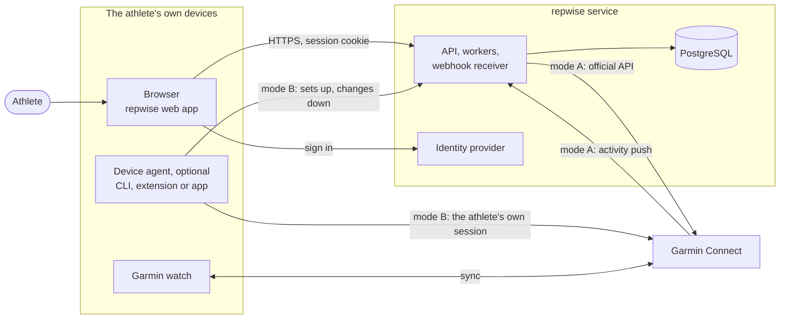

### Inside the cluster

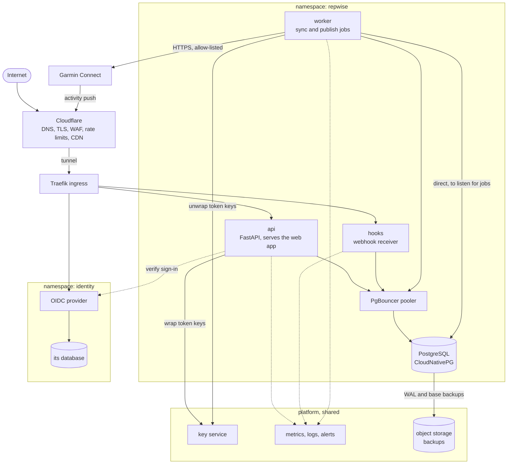

The three processes are one image started three ways. They are separate so
that each fails and scales by itself: a slow page must never make the service
miss a push from Garmin, and a queue of syncs must never slow a page down. At
the smallest size they run together in one pod.

## Components

| Component | Choice | Job | In the homelab today |
| --- | --- | --- | --- |
| Edge | Cloudflare, through the existing tunnel | TLS, DNS, WAF, rate limits, bot check on sign-up, caching the web app | Yes |
| Ingress | Traefik | Routes hosts to services | Yes |
| Web app | React, Vite, TypeScript, Mantine, TanStack Query | Routine editor, history, Garmin connection, sync status | No |
| `api` | FastAPI on Uvicorn | The JSON API. Holds the browser's session. Serves the web app's files | No |
| `hooks` | The same image | Takes Garmin's pushes, checks them, queues a job, answers at once | No |
| `worker` | The same image | Runs sync and publish jobs: parse sets, run the planner, call the gateway | No |
| Queue | Procrastinate, on PostgreSQL | Jobs, retries, a lock per athlete, periodic tasks | No, and nothing new to run |
| Database | PostgreSQL through CloudNativePG | Everything the service knows | Operator yes, cluster no |
| Connection pooler | CloudNativePG's PgBouncer | Keeps many pods from exhausting connections | No. From 100 users |
| Identity provider | Authentik | Registration, passkeys, social sign-in, email verification | No |
| Key service | A Kubernetes Secret first, OpenBao's transit engine later | Holds the key that wraps every Garmin token key | No |
| Cache and pub/sub | Valkey | Rate-limit counters, live job updates across replicas | No. From 100 users |
| Object storage | Garage on the NAS, with a copy off site | Database backups, data exports | Garage yes, off-site copy no |
| Email | An SMTP provider, used by the identity provider | Verification and recovery mail | No |
| Observability | Prometheus, Alertmanager, Grafana, Loki | Metrics, logs, alerts, an uptime check from outside | No. The homelab has none |
| Delivery | ArgoCD, Image Updater, cosign, Kyverno, Dependabot | GitOps, signed images, dependency updates | Yes |
| Device agent | The repwise CLI first | The Garmin half of a sync, on the athlete's device | Not a cluster component |

Notes on the choices that are not obvious:

- **One image, three commands.** `repwise-service api`, `hooks`, `worker`, and
  `migrate` for schema changes. One build, one version, nothing to keep in step.
- **The queue is the database.** Procrastinate stores jobs in PostgreSQL and
  takes a `lock` per job, so two syncs for one athlete never overlap, which is
  the in-process lock of today made to work across replicas. A separate broker
  is only worth running when the job table itself becomes the bottleneck.
- **Authentik, behind plain OIDC.** The service knows an issuer URL and nothing
  else about the provider, so replacing it later is configuration. It is
  preferred here because sign-in was already asked to be an existing service's
  job and not hand-written.
- **The browser never holds a token.** The API runs the OIDC exchange itself
  and gives the browser a session cookie it cannot read from JavaScript. This
  is the *backend for frontend* pattern, and it is what keeps a script injected
  into the page from stealing a sign-in.
- **Polling before streaming.** The page asks for a job's status every two
  seconds, as the trigger page does now. Live updates need a pub/sub channel
  once there is more than one API replica, and nothing about a 20-second sync
  needs them.

### Where the code lives

| Repository | Holds |
| --- | --- |
| `repwise` | The domain, the planner, the CLI, and the CLI's agent mode, still published to PyPI. Under `web/`, the FastAPI app, the web app and the image build |
| `homelab` | Manifests only: what runs, where, and with which image tag |

This was decided with [version one](PLAN.md#where-the-code-lives). `web/` is a
project of its own inside the repository, with its own dependencies and
lockfile, because the CLI's checks assume one Python package. It depends on a
pinned release of `repwise`, as the trigger image does now.

## Flows

### Signing in

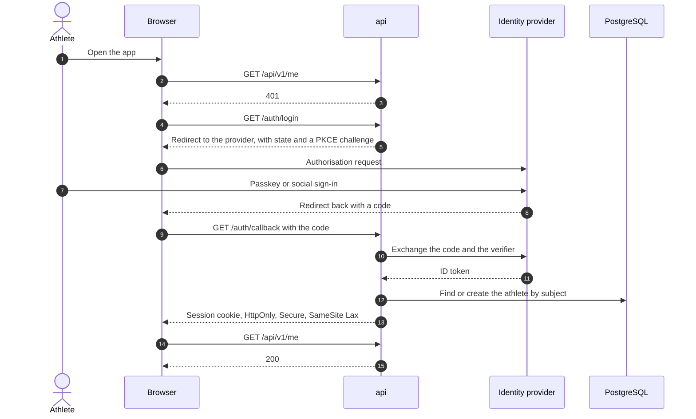

### Connecting Garmin, mode A

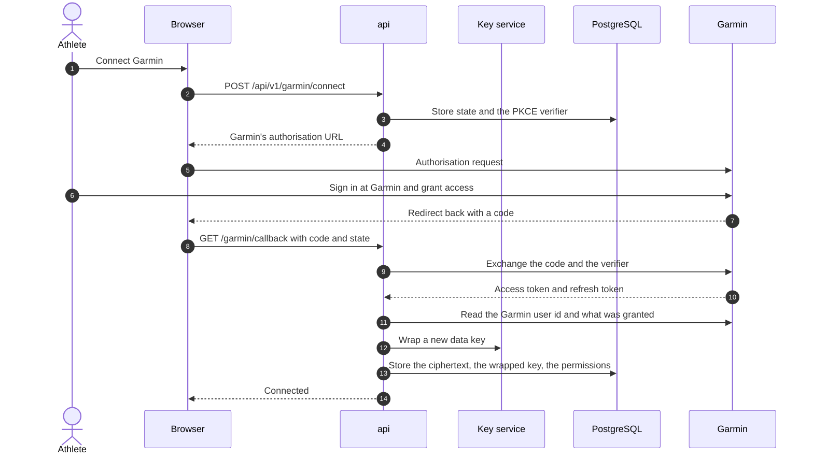

The password is typed at step 6, to Garmin. The code at step 7 passes through
the browser and Cloudflare, and is worthless to either: it is exchanged once,
and only together with the verifier that never left the API.

### After a session, mode A

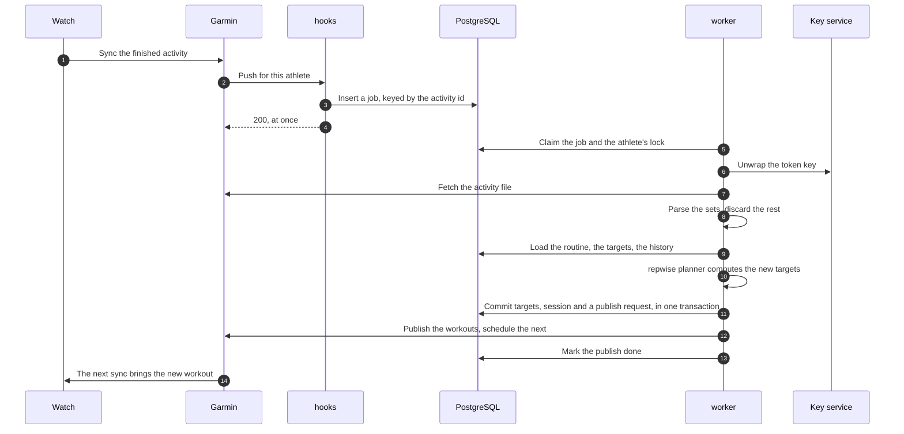

Deciding and publishing are two steps on purpose. The targets are committed
before Garmin is told, with a note that a publish is owed. If the publish
fails it is tried again from that note, and since it always sends the whole
workout as the database has it, sending it twice does no harm. The reverse
order could leave Garmin ahead of the database, and the next sync would then
advance a target twice.

The job is keyed by the activity id, so a push Garmin delivers twice makes one
job.

### A sync through the device agent, mode B

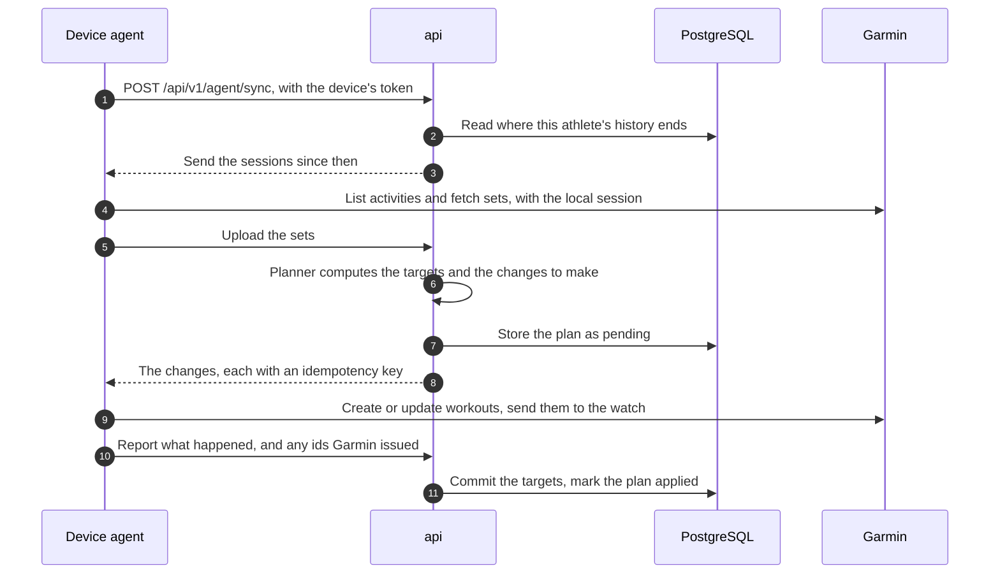

This is repwise's existing split made into a protocol.
[Only the planner mutates a workout, and it performs no I/O](docs/architecture.md#dependencies):
the service is the planner, the agent is the session. The agent holds no rules
and the service holds no credentials.

A plan stays pending until the agent reports back. An agent that dies halfway
asks again, is given the same plan with the same keys, and repeats only what
did not happen.

### Editing a routine

1. The web app sends the edited routine to `PUT /api/v1/routines/{id}`.
2. The API validates it with the same code `repwise` uses to load a config, so
   an editor and a CLI cannot disagree about what is valid.
3. A new revision is stored. The previous one stays, which is the undo.
4. A publish job is queued. It reshapes the Garmin workouts to match, carrying
   each exercise's current target over, as `update` does today for a workout
   no session touched.

### Disconnecting, and deleting an account

- **Disconnect:** the service revokes its access at Garmin, deletes the stored
  tokens and the key that wrapped them, and stops accepting pushes for that
  athlete. The routine and history stay.
- **Garmin tells us first:** an athlete can also withdraw access in Garmin
  Connect. Garmin's deregistration notice triggers the same deletion.
- **Delete the account:** everything with that athlete's id is deleted,
  including the identity provider's record. Deleting the wrapped key makes any
  token still sitting in an old backup unreadable.
- **Export:** one request produces the routine as `workouts.yaml` and the
  session history as JSON.

### The life of a sync job

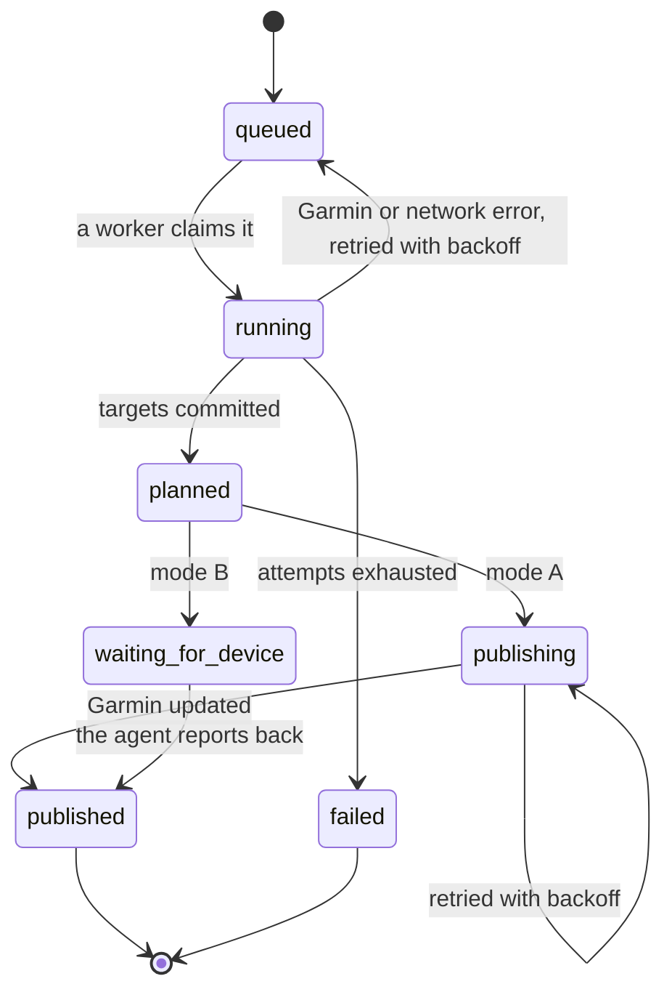

## Data model

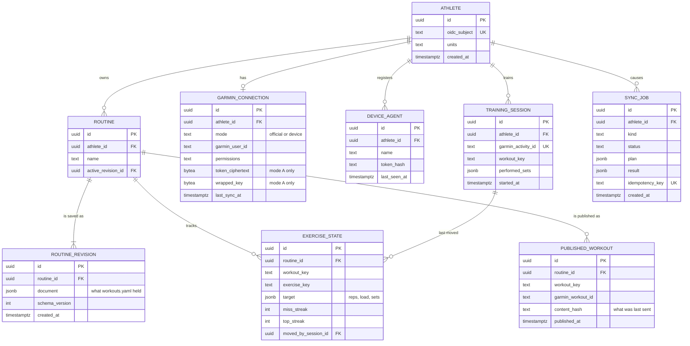

- **A routine is a document, a target is a row.** The routine is edited and
  saved whole, as the YAML file was, so a revision is one JSON document. A
  target changes one exercise at a time and is asked about constantly, so it is
  a row.
- **A session's sets are one document.** Twenty thousand athletes log around
  125 million sets a year. Stored one row per session, that is 4 million rows
  with the sets inside, which needs no partitioning for years.
- **The activity file is not kept.** It carries heart rate and sometimes
  position, neither of which the rules use. The worker parses out the sets and
  drops the file. Less to store, and less to answer for.
- **Every row carries the athlete's id,** and PostgreSQL's row-level security
  refuses any query that has not said which athlete it is acting for. A missing
  `WHERE` clause then returns nothing instead of somebody else's routine.

## Security

### What there is to protect

| Asset | Why it matters | Where it lives |
| --- | --- | --- |
| Garmin passwords | Full control of an account, and often reused elsewhere | Nowhere in this system, in either mode |
| Garmin OAuth tokens, mode A | Access within what the athlete granted | PostgreSQL, encrypted. The key that unlocks them is elsewhere |
| Garmin session, mode B | Full control of an account | The athlete's device only |
| Training history | Health data in law, see below | PostgreSQL |
| Sign-in to repwise | Access to the above | The identity provider. Passkeys preferred |
| Session cookies | A signed-in browser | The browser, unreadable by scripts. A hash in PostgreSQL |

### Who can see what

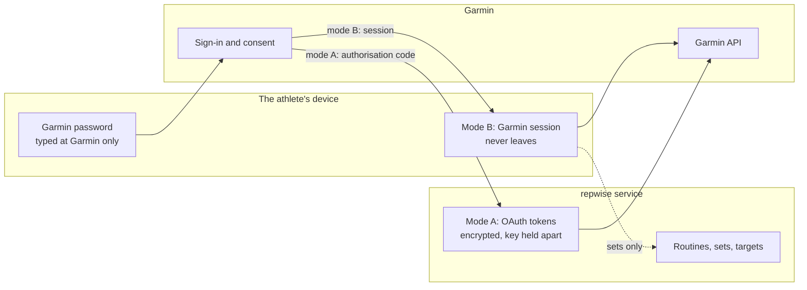

Cloudflare sits between every browser and the service and decrypts what passes.
In this design that is routines, sets and single-use authorisation codes. It is
never a Garmin password, which was the weakness accepted for the login form on
today's trigger page.

### Threats and what answers them

| Threat | Answer |
| --- | --- |
| The database is copied | Tokens are encrypted, each with its own key, and those keys are wrapped by one the database does not hold. No passwords exist to find |
| A worker is taken over | It can use tokens while the attacker is present. They are limited to granted permissions, withdrawn by the athlete or by us in one call, and every unwrap is logged by the key service |
| One athlete reads another's data | Row-level security on every table, an API role that cannot bypass it, and a test that fails any query run without an athlete set |
| A repwise account is taken over | Passkeys or a second factor at the identity provider. Signing in again before connecting, disconnecting, exporting or deleting |
| A forged push from "Garmin" | A push is treated as a hint to go and fetch, with our own token, and never as data. How Garmin lets a receiver authenticate one is to be confirmed |
| A stolen authorisation code | PKCE: the code is useless without the verifier, which stays in the API |
| A script injected into the page | A strict Content-Security-Policy. No token in the browser to steal. The session cookie is HttpOnly |
| A request forged from another site | SameSite cookies, and a CSRF token on every request that changes something |
| Sign-up abuse and floods | A bot check on registration, verified email, rate limits at Cloudflare, a quota of jobs per athlete, size limits on every body |
| A poisoned dependency | What the homelab already does: signed images checked on admission, a vulnerability gate, Dependabot with a cool-down. The web app adds npm, installed from a lockfile with scripts off |
| Us | In mode A an operator could act on an account within its permissions. Every such call is in an audit log. Mode B gives us no access at all, and is offered for exactly that reason |

### Keeping the tokens

Mode A needs tokens the service can use by itself, so they cannot be encrypted
with something only the athlete has. What can be done is to make the database
alone worthless:

- Each connection gets its own random *data key*, which encrypts that
  athlete's tokens.
- The data key is stored *wrapped*: encrypted by a master key that is not in
  the database.
- At first the master key is a Kubernetes Secret, encrypted in git like the
  homelab's others. From 100 users it moves into OpenBao's transit engine, so
  that no application pod ever holds it and every use is recorded.
- Deleting an athlete's wrapped data key destroys their tokens everywhere at
  once, old backups included.

### The law

This is not legal advice, and it needs someone qualified before a public
launch.

- **Training data is health data.** Under the GDPR that is a special category,
  which needs explicit consent and makes a data protection impact assessment
  likely.
- **The duties that follow** are a privacy policy, a way to export, a way to
  delete, a record of what is processed and why, agreements with whoever
  processes on our behalf (Cloudflare, the mail provider), and a breach
  notification within 72 hours.
- **Garmin has terms of its own:** a public website and a privacy policy to
  apply, and whatever the agreement says about deleting data when an athlete
  disconnects.
- **Keeping less is the cheapest compliance.** Sets only, no activity files, no
  position, no heart rate.

### In the cluster

The conventions the homelab already has apply unchanged: the `restricted` pod
security standard, non-root with a read-only root filesystem, a Cilium policy
per workload that names the hosts it may reach, and images verified by Kyverno.
Three things are new:

- **Three database roles.** `migrate` owns the tables. `api` and `worker` do
  not, so row-level security binds them.
- **Only `worker` may reach Garmin and unwrap keys.** `api` wraps a key when an
  athlete connects and can never read one back.
- **`hooks` has its own hostname** and accepts one path. Nothing else is
  reachable through it.

## Scaling

### What runs out first

1. **Garmin.** The Starter tier's user cap, then the API's call quota. In mode
   B there is no shared quota, but nothing syncs unattended.
2. **The home server.** Twelve cores and 96 GiB across three machines is more
   compute than 1,000 concurrent users need. What it lacks is a second of
   anything: one uplink, one NAS holding every volume, one control-plane node.
3. **Database connections,** once there are many pods, which a pooler fixes.
4. Everything else, a long way behind.

### The four sizes

| | 1 | 10 | 100 | 1,000 |
| --- | --- | --- | --- | --- |
| What it is | Today | Friends, by invitation | Public beta | A real service |
| `api` | The trigger pod | 1 pod, running all three roles | 2 pods | 4 to 10, scaled on CPU |
| `hooks` | None | In the same pod | 2 pods | 2 to 3 |
| `worker` | A thread | In the same pod | 2 pods | 3 to 10, scaled on queue length |
| PostgreSQL | None | 1 instance | 1 primary, 1 or 2 standbys, automatic failover | The same, larger, with a replica for history queries |
| Pooler | None | None | PgBouncer | PgBouncer, 2 pods |
| Queue | None | PostgreSQL | PostgreSQL | PostgreSQL, or a broker if the job table is the bottleneck |
| Valkey | None | None | Optional | Yes |
| Identity provider | oauth2-proxy and GitHub | Authentik, 1 pod | 2 pods | 2 to 3 pods |
| Web app served by | The pod | The `api` pod | Cloudflare's cache | Cloudflare's cache |
| Job status in the page | Polling | Polling | Polling | Streamed |
| Backups | None needed | Nightly, to the NAS | Continuous, with a copy off site and a restore rehearsed | The same |
| Monitoring | Pod logs | Pod logs, an uptime check | Metrics, alerts to a phone | The same, with objectives and someone on call |
| A deploy | Seconds of downtime | Seconds of downtime | None | None |
| Losing a node | Down until it returns | Down for minutes | Carries on | Carries on |
| Garmin | Unofficial, own session | CLI agent, or Starter | Starter, if its cap allows, or agents | Enterprise, or agents |
| Runs on | Homelab | Homelab | Homelab, with its limits written down | Probably not the homelab |

The smallest multi-user shape:

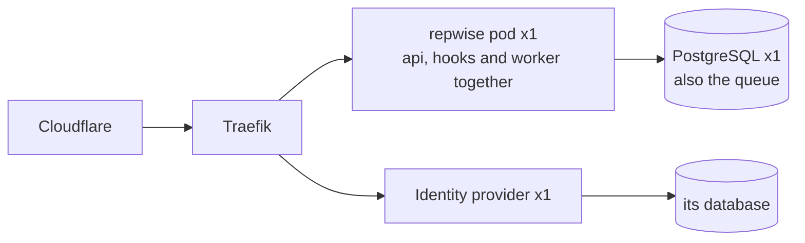

And the largest planned:

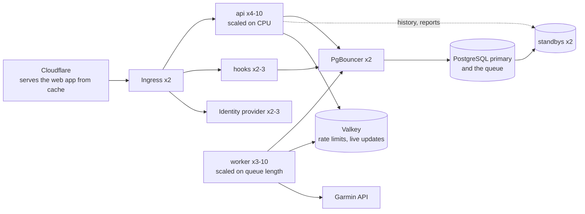

### What has to be right from the first day

These cost little now and a rewrite later, so the 10-user version has them
even though it does not need them.

- **Every row belongs to an athlete,** with row-level security on.
- **No process remembers anything.** Sessions, locks, job results and the
  login waiting for its code all live in the database. The trigger page keeps
  all four in memory, which is why it can only ever be one replica.
- **Every job can run twice.** Keyed by what caused it, and written so that a
  repeat changes nothing.
- **The Garmin gateway is an interface** from the start, with the unofficial
  session as its first implementation.
- **Schema changes come in two steps:** add the new shape, deploy, then remove
  the old. That is what lets two versions run side by side during a rollout.
- **Nothing is written to a local disk.**
- **The API has a version in its path,** because device agents in the field
  cannot all be updated at once.

### The trade-offs

| Decision | What it buys | What it costs |
| --- | --- | --- |
| PostgreSQL instead of a file in git | Many athletes, many writers, queries | History, review and rollback have to be built. Schema migrations exist |
| Targets in our database, not in Garmin | Works with an API that cannot read a workout back. One source of truth | An edit made in Garmin Connect is overwritten, not noticed |
| A queue instead of running at once | Survives restarts, retries, levels the evening peak | The page says "queued". Every job must be safe to repeat |
| Processes that remember nothing | Replicas, rolling deploys | More trips to the database |
| Official API | No passwords, syncs unattended, a quota to grow into | Garmin's approval, Garmin's limits, only what the API exposes |
| Device agent | No approval, no Garmin secrets held, no shared rate limit | Something to install. No sync while the device sleeps. An unofficial API that can change under us |
| Tokens the server can use | Unattended sync | We hold something worth stealing, and must run key management |
| One schema with row-level security | Cheap, and scales to any number of athletes | Isolation depends on policy being correct. A database per athlete would isolate harder and cost far more to run |
| One codebase, three processes | One build, one version | A team that grows may want to split it. Nothing here prevents that |
| The queue in PostgreSQL | Nothing extra to run, and a job commits with the data it changes | A ceiling of some thousands of jobs a minute, far above the 80 planned |
| Polling for job status | Works across replicas with no extra parts | A two-second delay, and requests that mostly learn nothing |
| Our own identity provider | No per-user fee, data stays here | One more thing to keep up, patched and backed up |
| Keeping only the sets | Little to store, little to leak, little to answer for | A new rule cannot be run over old activity files |
| The homelab | No bill, full control | One site. See below |

### When to leave the homelab

The manifests are GitOps and the images are signed and public, so the service
can be pointed at another cluster without being rewritten. What decides the
moment is not load:

- **An athlete relying on it.** A home uplink and one NAS cannot honestly
  promise more than "usually up".
- **Garmin's pushes.** If the receiver is down when a push arrives, the sync
  waits on Garmin's retries. How long Garmin retries is to be confirmed.
- **Data that cannot be re-created.** The homelab's own documentation names the
  NAS as its one unrecoverable loss. For one person's routine that was
  acceptable. For other people's training history it is not.

The order to move in: backups off site first, at 10 users. Then the database to
a second site or a managed service. The stateless pods last, since they are the
easy part.

## Changes to repwise itself

The service uses repwise as a library, and its layering already allows most of
that. What has to change:

- **`GarminSession` becomes one implementation of a gateway interface.** Two
  more join it: the official API, and one that hands its calls to a device
  agent.
- **The current target is passed in, not read from the Garmin payload.** The
  planner takes it from whatever the caller holds. The CLI goes on reading it
  from Garmin, so nothing changes for a self-hosted user.
- **A config can be loaded from a document, not only from a path.** The
  validation is the part worth sharing with the web editor.
- **A plan and its report become data.** They are already separate objects.
  They need a JSON form so that the API can return them and an agent can
  apply them.
- **A second payload builder** for the Training API's shape, beside
  `garmin/payloads.py`, and a reader for the set messages in a FIT file.
- **An agent mode for the CLI:** `repwise agent sync`, which runs the
  [device agent flow](#a-sync-through-the-device-agent-mode-b) against a
  service.

The recorded dumps repwise already uses in its tests are the safety net: the
service must produce the same plan from them as the CLI does.

## What goes into the homelab repository

Manifests only, following the conventions already there.

- `kubernetes/kustomizations/repwise-service/`: the `api`, `hooks` and `worker`
  Deployments, their Services, two Ingresses, a Cilium policy each, the
  CloudNativePG `Cluster`, and from 100 users a `Pooler`, autoscalers and
  disruption budgets.
- `kubernetes/helm/authentik/` and its own CloudNativePG cluster.
- A monitoring stack, which the homelab does not have: Prometheus, Alertmanager,
  Grafana and Loki.
- Later: `valkey`, `openbao`, and KEDA to scale workers on queue length.
- An `Application` and an `ImageUpdater` entry for each in the app-of-apps
  chart.
- Secrets, encrypted with git-crypt like the rest: the Garmin client id and
  secret, the OIDC client secret, the master key, the mail provider's password.
- Cloudflare: two hostnames on the tunnel, one for the app and one for `hooks`,
  with WAF and rate-limit rules.
- A scheduled backup to Garage, and the off-site copy.
- The existing `repwise` namespace with the trigger page stays as it is until
  the service has replaced it for its one user.

## Roadmap

Each phase ends in something that can be checked.

**Phase 0: three spikes, before anything is built.**

| Spike | Question | Answered when |
| --- | --- | --- |
| Garmin's official API | Does Garmin approve, does the Training API take a strength step with reps and load, do delivered FIT files carry sets | A strength workout made through the API runs on a watch, and a pushed activity yields its sets |
| The device agent | Can the CLI run the Garmin half of a sync on a plan it did not compute | `repwise agent sync` against a stub service changes a real workout |
| The library seams | Can the planner run with the target passed in | The existing test suite passes with the planner fed from a dictionary |

**Phase 1: the same single user, on the new foundations.** FastAPI and React
replace the trigger page. State moves into PostgreSQL. Garmin is still reached
through the unofficial session.
*Done when* the service and the CLI produce the same plan from the same
recorded sessions, and the trigger page is switched off.

**Phase 2: many athletes, by invitation.** The identity provider, the athlete
id on every row with row-level security, the routine editor, the queue, and the
CLI as device agent.
*Done when* two invited athletes use it for a month and a test proves neither
can read the other's data.

**Phase 3: the official API, if Phase 0 allowed it.** Connecting through
Garmin, the webhook receiver, syncing without being asked.
*Done when* a session finished on a watch changes the next workout's targets
with nobody opening the app.

**Phase 4: ready for strangers.** Standby database, the pooler, monitoring and
alerts, backups off site with a rehearsed restore, export and deletion, the
legal review, and a load test.
*Done when* a test holding 1,000 simulated users for an hour stays within its
response-time target, and a restore from backup has been done once for real.

## Open questions

**For Garmin, and blocking mode A:**

- Does a hobby project qualify for the Starter tier?
- How many athletes does Starter allow, and what does Enterprise cost?
- Does the Training API accept strength steps with a rep target and a load?
- Can an app change a workout it published, or only replace it?
- Does a scheduled workout reach the watch without the athlete doing anything?
- Is the FIT file delivered through the Activity API complete?
- How is a push authenticated, and for how long is a failed one retried?
- What are the call quotas?

**For us:**

- Is running a public service that depends on Garmin's unofficial API, even
  from athletes' own devices, a risk worth taking if Garmin refuses?
- Who is the legal operator of the service, and where?
- Is the homelab acceptable for a public beta, with its limits stated?
- Should the personal API key be explored as a third route? It is official,
  needs no approval and is read-only. Paired with a Connect IQ app that fetches
  the next workout onto the watch directly, it might avoid both the business
  program and the unofficial API. Garmin pointed at least one strength app
  towards Connect IQ. Nothing about this is verified.

## Sources

Garmin's program changed twice in 2026, so what is said about it above is dated
and should be checked again before being relied on.

- [Garmin Connect Developer Program overview](https://developer.garmin.com/gc-developer-program/overview):
  the three tiers and what each includes.
- [Training API](https://developer.garmin.com/gc-developer-program/training-api)
  and [Activity API](https://developer.garmin.com/gc-developer-program/activity-api/):
  what each publishes or delivers.
- [OAuth 2.0 PKCE specification](https://developerportal.garmin.com/sites/default/files/OAuth2PKCE.pdf):
  how an app is authorised.
- [Garmin personal API](https://the5krunner.com/2026/10/22/garmin-personal-api/),
  the5krunner, October 2026: the reopening, the personal tier, the Starter
  review.
- [Garmin freezes developer API access](https://the5krunner.com/2026/09/14/garmin-developer-api-access-paused/),
  the5krunner, September 2026: the pause.
- [Garmin Connect+ and strength apps](https://the5krunner.com/2026/03/24/garmin-connect-plus-strength-apps/),
  the5krunner, March 2026: the restricted offer made to a strength app.
- [Persistent 429 on API login](https://forums.garmin.com/developer/fit-sdk/f/discussion/435087/persistent-429-on-api-login-account-blocked-for-48-hours),
  Garmin forums: rate limiting of unofficial sign-ins.
- [python-garminconnect](https://github.com/cyberjunky/python-garminconnect):
  the unofficial client repwise uses today.
- [docs/architecture.md](docs/architecture.md) and
  [docs/garmin-api.md](docs/garmin-api.md) in this repository: what repwise
  does now.
