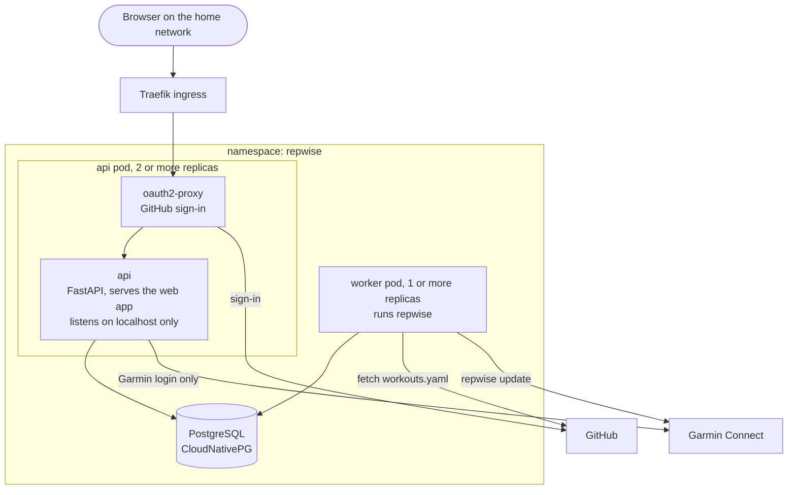
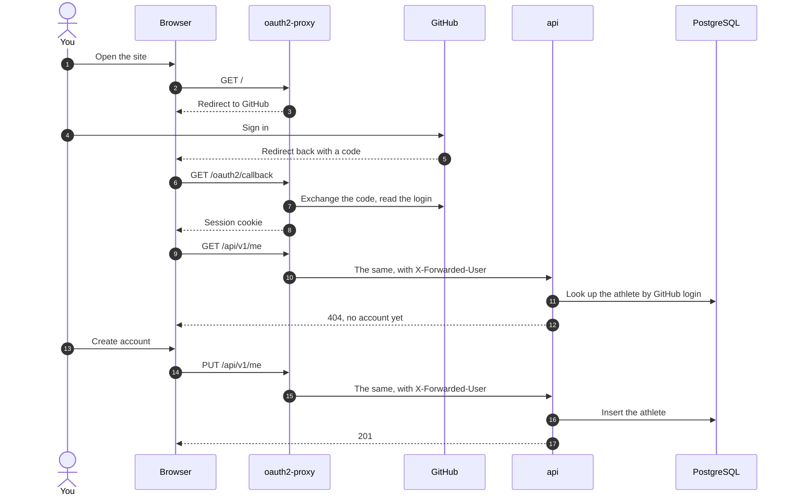
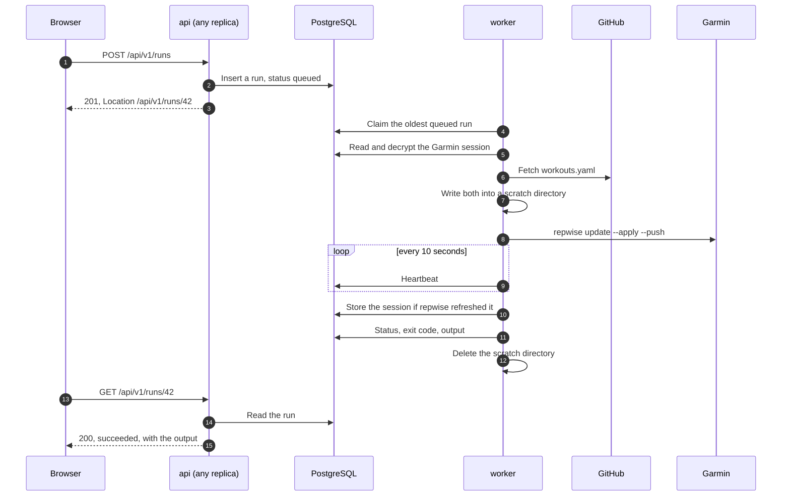
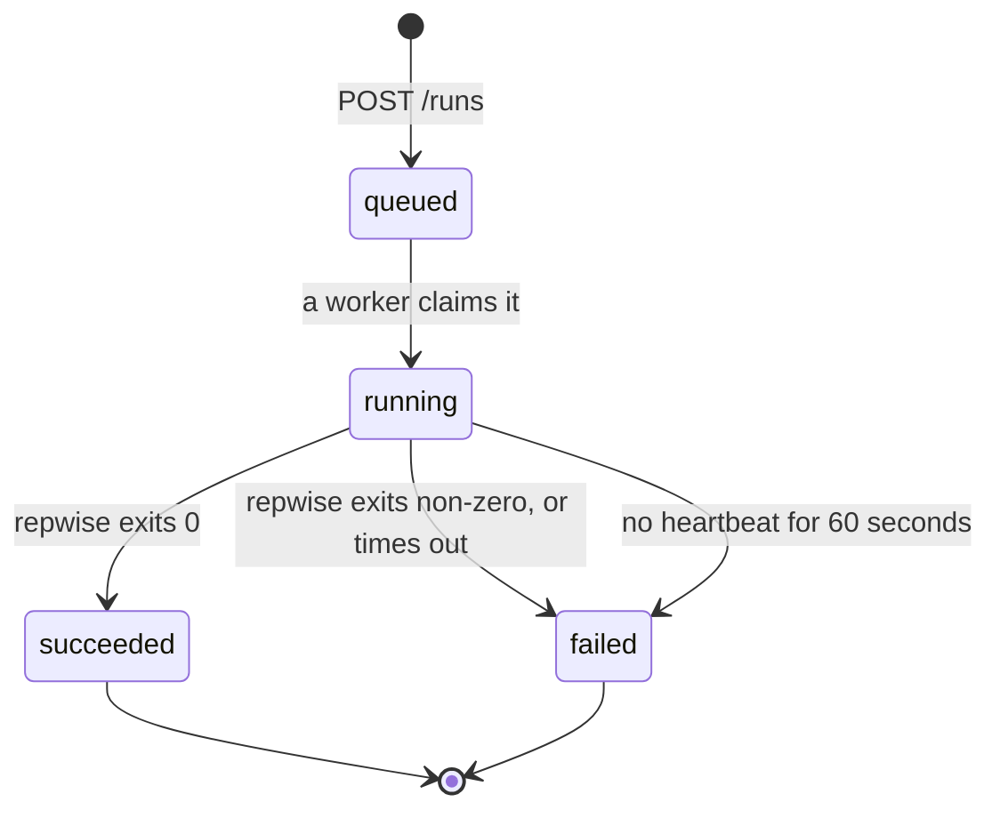
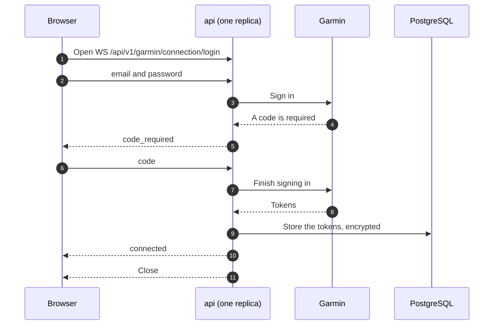
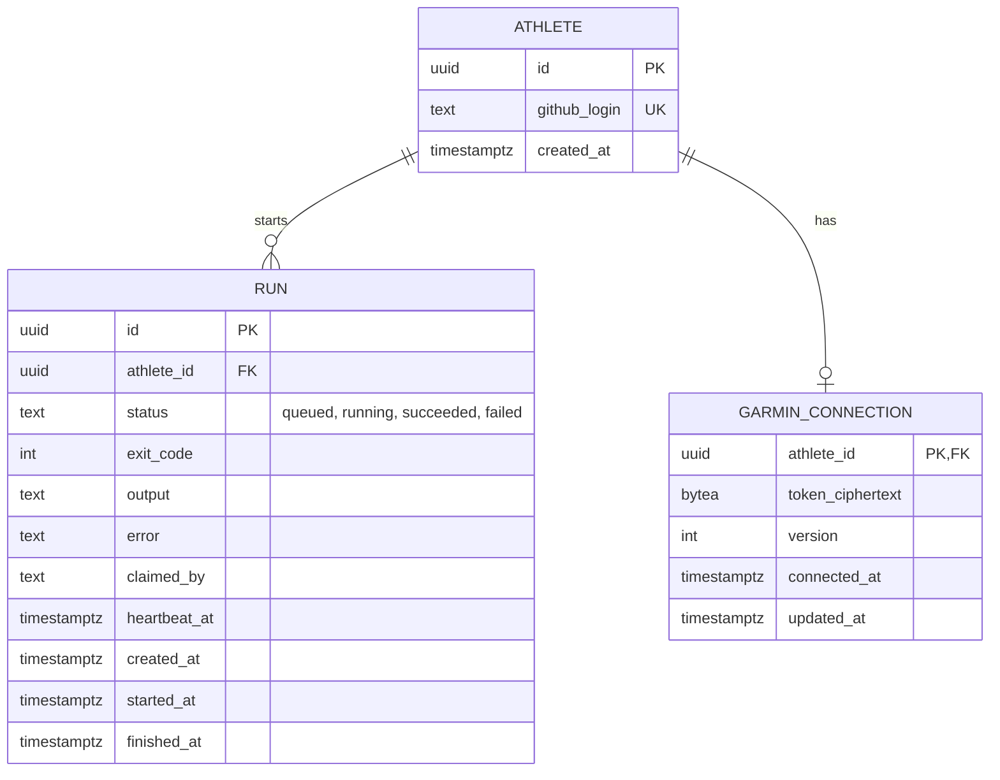

# repwise on the web, version one: plan

Status: built under [`web/`](web/). Steps 1 to 6 of the
[build order](#build-order) are done: checked locally, and on the cluster in
`repwise-test` on 2026-11-15. Step 7 is
[theadzik/homelab#446](https://github.com/theadzik/homelab/pull/446), with the
trigger removed after it once a real run has been checked. Written 2026-11-14.

The page that runs `repwise update` from a phone keeps what it knows in the
memory of one pod. Restart the pod and it says "Not run since the pod started",
and it can never be more than one replica. This plans its replacement: the same
job for the same one athlete, with an account to sign in to and a backend that
keeps nothing in the pod.

The larger idea, a public service for many athletes, is in
[PLAN-multi-user.md](PLAN-multi-user.md). This version is cut down from it and
built so that it can grow into it.

- [Summary](#summary)
- [Scope](#scope)
- [What the pod holds today, and where it goes](#what-the-pod-holds-today-and-where-it-goes)
- [Architecture](#architecture)
- [Signing in and registering](#signing-in-and-registering)
- [The API](#the-api)
- [A run, start to finish](#a-run-start-to-finish)
- [The Garmin session](#the-garmin-session)
- [Data model](#data-model)
- [Security](#security)
- [Where the code lives](#where-the-code-lives)
- [In the homelab](#in-the-homelab)
- [Scaling](#scaling)
- [How it is checked](#how-it-is-checked)
- [Build order](#build-order)
- [Decisions](#decisions)
- [Left for later](#left-for-later)

## Summary

1. **Everything the pod remembers moves into PostgreSQL.** The last run, the
   lock that stops two runs overlapping, and the Garmin session all become rows.
   Any replica can then answer any request, and a restart loses nothing.
2. **A REST backend and a separate web app.** FastAPI serves a JSON API. A
   React app is the page. They ship in one image.
3. **Runs are done by a worker, not by the web server.** Pressing the button
   creates a run. A worker picks it up, runs `repwise` exactly as the page does
   now, and writes the result back.
4. **Signing in stays GitHub, through the oauth2-proxy already in place.** The
   first sign-in by an allowed account registers it.
5. **Garmin is reached the way it is now:** the unofficial API, with one
   athlete's session held by the service. No developer program is involved.
6. **One endpoint is not REST, on purpose.** Signing in to Garmin with a code
   takes two steps that must share a live connection to Garmin. That
   conversation runs over a WebSocket, and the half-finished login waits in
   the replica's memory for ten minutes, so that a phone that drops the socket
   can bring the code on a new one.
7. **Two ways out.** One button signs out of the site, another makes the
   service forget the Garmin session.
8. **Reachable from the home network only, for now.** No Cloudflare tunnel in
   front, which also means the Garmin password no longer passes through
   Cloudflare.

The routine stays where it is, in `workouts.yaml` in its git repository. Moving
it into the database, and an editor for it, is the next version.

## Scope

### In

- An account, created by signing in with GitHub.
- The Update button, and the result of every run, kept.
- Signing in to Garmin from the page, with a code when Garmin asks for one.
- Signing out, of the site and of Garmin, each with its own button.
- A backend with no state in the pod: any number of replicas, rolling updates.
- An address that resolves inside the home network only.
- A data model keyed by athlete, so a second athlete is a row and not a rewrite.

### Out

- More than the allowed GitHub accounts. See [Decisions](#decisions).
- Editing the routine. It is still fetched from git for every run.
- Garmin's official API, device agents, and everything else that exists to keep
  other people's Garmin access safe.
- Any change to repwise itself. It is still run as a command.

## What the pod holds today, and where it goes

This table is the whole reason for the version. The left column is every piece
of state in `server.py` and on its volume.

| Held in the pod today | What that costs | Where it goes |
| --- | --- | --- |
| `last`: the latest run's result and output | Gone on restart, which is the message on the page. Different in every replica | A `run` row per run |
| `running`: a lock in the process | Only one replica can exist, and a rollout has to stop the old pod first | A unique index: one queued or running run per athlete |
| The run itself: a thread and a subprocess in the web server | Dies with the pod | A worker that claims the row and reports a heartbeat |
| `pending`: a Garmin login waiting for its code | The code has to arrive at the same pod | Still in memory, for ten minutes. Traefik's sticky cookie brings the browser back to that pod |
| The Garmin tokens: a file on an NFS volume | Ties the pod to a volume, and a file is not safe with two writers | An encrypted row, written to memory-backed scratch for the length of a run |
| `workouts.yaml`: downloaded to the volume for each run | Nothing. It is replaced every run already | The same download, into scratch |
| Session dumps and the exercise catalog: caches on the volume | Nothing lost if they vanish | Scratch. Fetched again each run, at the cost of a few more Garmin calls |

After this the service has no volume at all. The claim `repwise-trigger-home`
and its storage class question go away with it.

## Architecture



| Component | Choice | Job |
| --- | --- | --- |
| Web app | React, Vite, TypeScript, Mantine, TanStack Query | Three screens: runs, Garmin, account |
| `api` | FastAPI on Uvicorn | The JSON API, the Garmin login, the web app's files |
| `worker` | The same image, another command | Claims a queued run, runs `repwise`, stores the result |
| Sign-in | oauth2-proxy, as now | GitHub sign-in, the session cookie, the allow-list |
| Database | PostgreSQL through CloudNativePG | Athletes, runs, the Garmin session |
| Queue | The `run` table itself | No broker and no queue library |
| Migrations | Alembic | Schema changes, applied before the API starts |

One image, three commands: `repwise-web api`, `repwise-web worker`,
`repwise-web migrate`.

**Why no queue library.** There is one kind of job and it already needs a
table, for its history. A row is claimed with `FOR UPDATE SKIP LOCKED`, which
is what the libraries do underneath. A library is worth adding when there is a
second kind of job or automatic retries are wanted.

**Why the API and the worker are separate pods.** A run takes up to ten
minutes and must survive a web server being replaced. Kept apart, the web
server can roll at any time, and only the worker needs the long grace period
the trigger pod has now.

## Signing in and registering

oauth2-proxy stays as a container beside the API in every `api` pod. It already
keeps its session in an encrypted cookie and nothing on the server, so any
replica accepts a cookie any other issued.



- **Who you are** is the `X-Forwarded-User` header, which oauth2-proxy sets to
  the GitHub login. The API trusts it because the API listens on localhost and
  the proxy is the only thing that can reach it, as now.
- **Registering is one explicit request.** `PUT /api/v1/me` creates the account
  for whoever is signed in, and does nothing if it exists. The page offers it
  when `GET /api/v1/me` answers 404.
- **Who may register** is still oauth2-proxy's `--github-user` list. Today that
  is one login.
- **The account is keyed by the GitHub login.** oauth2-proxy does not pass
  GitHub's numeric id. A login can be renamed and the old name taken by
  somebody else, who would then pass an allow-list that names it. The
  allow-list has that weakness already. It is closed when sign-in moves to a
  provider with stable subject ids, as the multi-user plan has it.
- **A request that changes something** must be sent as JSON, with the
  `Content-Type` header saying so. Another site cannot send that without the
  browser asking first. With the cookie's `SameSite=Lax` that is the defence
  against forged requests.

### Signing out

The account screen has a *Sign out* button. It is a link to
`/oauth2/sign_out`, which oauth2-proxy answers by deleting its session cookie.
There is nothing for the API to do, because the API never held the session.

- **Where it lands.** oauth2-proxy is switched from redirecting straight to
  GitHub to showing its own sign-in page, with `--skip-provider-button=false`.
  Without that, signing out would bounce through GitHub and straight back in,
  since GitHub still knows the browser.
- **What it does not do.** It does not sign the browser out of GitHub, and it
  cannot end a session in another browser. The session is the cookie, and no
  list of sessions is kept on the server. A cookie expires after 30 days, as
  now.

## The API

Everything is under `/api/v1`. Errors are `application/problem+json`.

| Method and path | Does | Answers |
| --- | --- | --- |
| `GET /me` | The signed-in athlete | 200, or 404 before registering |
| `PUT /me` | Register, or nothing if registered | 201 or 200 |
| `POST /runs` | Queue a run | 201 with `Location`. 409 with the active run's `Location` if one is queued or running. 409 if no Garmin session is held |
| `GET /runs` | Runs, newest first, without their output | 200 |
| `GET /runs/{id}` | One run, with its output | 200 |
| `GET /garmin/connection` | Whether a Garmin session is held, and since when | 200, or 404 |
| `DELETE /garmin/connection` | Sign out of Garmin: forget the session | 204 |
| `WS /garmin/connection/login` | The login conversation, [below](#signing-in-to-garmin) | |
| `GET /healthz` | Liveness, outside `/api/v1` | 200 |

Signing out of the site is not in this table. It is
[oauth2-proxy's own endpoint](#signing-out), `/oauth2/sign_out`.

The page shows the newest run from `GET /runs`, which is what replaces "Not run
since the pod started". While a run is queued or running it asks for
`GET /runs/{id}` every two seconds, as the page polls `/status` now.

The OpenAPI document FastAPI generates is the contract. The web app's client
types are generated from it, so the two cannot drift.

## A run, start to finish





- **One run at a time, enforced by the database.** A unique index allows one
  row per athlete with status `queued` or `running`. Two presses at once, on
  two replicas, give one run and one 409.
- **Claiming** is one statement: take the oldest queued row with
  `FOR UPDATE SKIP LOCKED`, mark it running, record which worker has it. Two
  workers can never claim the same row.
- **A worker that dies is noticed.** It writes a heartbeat every ten seconds.
  Any worker marks a running row failed when its heartbeat is a minute old,
  with the reason "worker lost".
- **A lost run is not retried.** It may already have changed Garmin. The page
  says it failed and the button is pressed again, which is no different from
  pressing it twice today.
- **A rollout does not kill a run.** The worker finishes the run it holds
  before exiting, inside the 630-second grace period the trigger pod has
  today.
- **The check the page makes now stays:** a workout with no `garmin_workout_id`
  fails the run with the same explanation, before repwise is started.
- **Workers poll** for a queued row every two seconds. That is at most two
  seconds added to a run that takes far longer.

## The Garmin session

### Keeping it

What garminconnect stores is a small JSON document holding a refresh token,
which is as good as being signed in. It moves from a file on a volume to one
row, encrypted with a key from a Kubernetes Secret.

- **At rest:** ciphertext in `garmin_connection`. The key is not in the
  database, so a copy of the database alone cannot use it.
- **During a run:** the worker decrypts it into a scratch directory backed by
  memory, at the path the athlete's `workouts.yaml` names, with `HOME` pointed
  there. repwise finds its token store where it expects to and is not changed.
- **After a run:** repwise may have refreshed the token. The worker reads the
  file back and stores it if it differs.
- **Two writers:** a login and a run can both write the row. Each write names
  the version it read, and a write against an older version is dropped. A login
  always wins, since it is the newer truth.

### Signing in to Garmin

This is the one place the pod has to remember something, and the design keeps
that memory to one replica and ten minutes.

garminconnect signs in in two steps when Garmin wants a code. Between them it
holds a live HTTP session with Garmin, in private fields with no way to save
and restore them. Today the pod keeps that object in a variable until the code
arrives. With two replicas the code could arrive at the other one.

So the conversation runs over one WebSocket, which stays on one replica for as
long as it is open:



- A wrong code is answered with `code_rejected` and may be sent again, as now.
- If the connection drops, the half-finished login waits in memory for ten
  minutes from `code_required`. That message carries a `resume`, and a new
  connection that sends `{"resume", "code"}` picks the login up. A phone needs
  this: it closes the page's socket while the code is read in the mail app.
  Traefik's sticky cookie on the Service sends the browser back to the replica
  holding it. One login waits per athlete; five wrong codes end it, across
  connections. Nothing is written to the database until it finishes.
- The password is passed to Garmin and dropped, and never logged, as now.
- The handshake checks the `Origin` header, so another site cannot open it.
- A ping every 20 seconds keeps a proxy from closing an idle socket while a
  code is being typed.
- With the site internal, the password travels from the browser to Traefik
  inside the home network, and Cloudflare never sees it. If the site is made
  public again through the tunnel, Cloudflare can read it, as it could on the
  trigger page.

If a WebSocket turns out to be awkward through the proxy chain, the fallback is
to sign in with the CLI on a laptop and upload the token file through an
ordinary `PUT`. That is fully REST and keeps the password off the server, at
the price of needing the laptop.

### Signing out of Garmin

The Garmin screen has a *Sign out of Garmin* button, which sends
`DELETE /garmin/connection`. The row is deleted and with it the only copy of
the tokens the service had.

- A run already in progress finishes with the token it was given. It does not
  write the token back, because the row it would update is gone.
- While no session is held, `POST /runs` is refused with 409 and the page says
  to sign in to Garmin first.
- Garmin is not told. The unofficial API has no call that ends a session, which
  is also true of `repwise logout`. The tokens are forgotten, not revoked.

## Data model



- The unique index is on `run (athlete_id)` where the status is `queued` or
  `running`.
- Runs are kept. One athlete makes a few hundred small rows a year.
- The token is encrypted with Fernet, and the service accepts a list of keys:
  it encrypts with the first and decrypts with any. A key is replaced by
  putting the new one first, with no moment when nothing decrypts.
- Where the routine comes from is still configuration, the `CONFIG_URL` and
  token the trigger has now. It becomes a row per athlete when there is a
  second athlete or an editor.

## Security

What changes compared with the trigger page:

| | Today | Version one |
| --- | --- | --- |
| Garmin tokens at rest | A file on the NAS, readable by anything that mounts the share | Encrypted in PostgreSQL, key in a Secret |
| Garmin tokens in use | On the volume permanently | In memory-backed scratch for the length of a run |
| Garmin password | Through Cloudflare to the pod, passed on, dropped | Inside the home network to the pod, passed on, dropped |
| Who can reach the site | The internet, through the Cloudflare tunnel | The home network only |
| Who can press the button | One GitHub login, by oauth2-proxy | The same |
| Database access | None exists | `api`, `worker` and `migrate` share the role CloudNativePG makes, which owns the tables. A role that cannot alter them would stop the API dropping a table but not emptying it, so it waits for a second athlete |
| What can reach Garmin | The one pod | `worker`, and `api` for the login |

Unchanged: the `restricted` pod security standard, read-only root filesystems,
a Cilium policy per workload naming the hosts it may reach, signed images
verified on admission, and the API listening on localhost behind the proxy.

## Where the code lives

| Repository | Holds |
| --- | --- |
| `repwise` | The service, under `web/`, and the workflow that builds its image |
| `homelab` | The deployment, and nothing that is built |

```text
web/
    backend/        the Python package repwise_web: api, worker, migrations,
                    and their tests
    frontend/       the React app
    Dockerfile      one image for all three commands
    compose.yaml    PostgreSQL and two API replicas, for the checks below
```

- **`web/` is a project of its own,** with its own `pyproject.toml` and
  lockfile. The CLI's packaging, its checks and its coverage floors are not
  touched, and nothing under `web/` is shipped to PyPI.
- **It installs a released `repwise` from PyPI,** as the trigger image does.
  That makes `web/` the whole build context, and a repwise release reaches the
  service as a pull request from Dependabot.
- **The image is `ghcr.io/theadzik/repwise-web`,** built by the shared workflow
  the homelab's images use, so it is scanned and signed the same way and passes
  the same admission check. A pull request builds and scans without
  publishing. A tag `repwise-web-<CalVer>` publishes.
- **The workflow needs the DHI registry credentials** the homelab repository
  already has: the variable `DOCKERHUB_USERNAME` and the secret
  `DOCKERHUB_TOKEN`.

## In the homelab

Changes to `kubernetes/kustomizations/repwise/`:

- **`repwise-api` Deployment:** two replicas, rolling updates. Containers:
  oauth2-proxy with today's flags, and `api`. An init container runs `migrate`,
  which takes a database lock so that two pods starting together do not both
  migrate.
- **`repwise-worker` Deployment:** one replica to start.
  `terminationGracePeriodSeconds: 630`. An `emptyDir` with `medium: Memory` for
  scratch. No Service, no Ingress.
- **A CloudNativePG `Cluster`,** `repwise-db`, one instance, on an iSCSI class
  like tandoor's. The operator is already installed.
- **Network policies:** `api` from Traefik, and out to the database, GitHub and
  Garmin. `worker` out to the database, GitHub's API and Garmin.
- **Secrets:** the three that exist (the workouts token, the OAuth client, the
  cookie secret), and one new: the key that encrypts the Garmin session. The
  database password is the one CloudNativePG generates.
- **The Ingress becomes internal:** the Cloudflare annotations go and the label
  becomes `dns-type: internal`, as audiobookshelf has it. The hostname, the
  OAuth App and its callback URL stay. GitHub never calls the site itself, so
  signing in works on an address only the home network resolves.
- **oauth2-proxy** gains `--skip-provider-button=false`, for
  [signing out](#signing-out).
- **Removed:** the `repwise-trigger` Deployment, the claim
  `repwise-trigger-home`, and `apps/repwise-trigger/`.

Cutting over means signing in to Garmin once more through the new page, since
the session moves to new storage. Nothing else carries over, because the old
page kept nothing.

### Trying it first

Before any of that, the service is tried in a namespace made by hand,
`repwise-test`, applied with `kubectl` and outside ArgoCD. It has no Ingress
and no oauth2-proxy: a GitHub OAuth App has one callback URL, and that belongs
to the real site. A small proxy that sets `X-Forwarded-User` stands in for it,
reached by port-forward. The namespace is deleted afterwards. What it cannot
show is the real sign-in, which is first exercised at the cut-over.

## Scaling

"Scalable" here means the pods are interchangeable. What that gives:

| | Trigger page | Version one |
| --- | --- | --- |
| `api` replicas | Exactly 1 | Any number |
| Updating | Stop the old pod, then start the new one | Rolling, with no gap |
| A pod restarting | Forgets the last run. Kills a run in progress | Loses nothing. A run in progress is unaffected unless it was that worker's |
| Workers | The web server | Any number. Each athlete still has one run at a time |
| What holds state | The pod and an NFS volume | PostgreSQL alone |

What it does not change:

- **PostgreSQL is one instance.** While it restarts, the site is down. Raising
  `instances` to three is one line, and what tandoor's cluster already runs.
- **Garmin sees every call from one address.** That is fine for one athlete and
  is the reason this design must not be opened to many. See
  [PLAN-multi-user.md](PLAN-multi-user.md#four-ways-to-hold-the-keys).

## How it is checked

Tests never run a real `repwise update --apply` and never sign in to Garmin.
They use a stand-in `repwise` command and a stand-in `garminconnect`, as the
trigger page's tests did.

| Claim | Check |
| --- | --- |
| A restart forgets nothing | Finish a run, restart every `api` pod, load the page: the run is still shown |
| Any replica answers | Create a run through one replica, read it through another |
| One run at a time | Send `POST /runs` twice at the same instant to two replicas: one 201, one 409 |
| A dead worker is noticed | Kill the worker mid-run: the run is `failed` with "worker lost" within a minute, and a new run can start |
| A rollout does not kill a run | Roll the worker mid-run: the run finishes |
| The login survives a dropped socket | Sign in with a wrong password, with a code, with a wrong code then the right one. Drop the socket after `code_required`, send the code on a new one, and confirm nothing was stored before it |
| Signing out of Garmin forgets the tokens | After it the row is gone and `POST /runs` answers 409. A run that was in progress does not put the token back |
| Signing out of the site ends the session | After it, a request to the API is refused until signing in again |
| The token is not readable at rest | Dump the database and search it for `di_refresh_token`: no match |
| Nothing is on disk | The pods run with no volume but memory-backed scratch |

## Build order

Each step ends in something that runs.

1. **The skeleton.** The image, `api` with `/healthz`, the database, Alembic,
   the `athlete` table, `GET` and `PUT /me`. *Check:* registering twice gives
   one row.
2. **Runs.** The `run` table and its index, the three run endpoints, the worker
   with claim, heartbeat and the lost-worker rule, against a stand-in
   `repwise`. *Check:* the first five rows of the table above.
3. **The Garmin session.** The encrypted row, writing it to scratch and reading
   it back, the WebSocket login against a stand-in `garminconnect`, `DELETE`.
   *Check:* the login and token rows of the table above.
4. **The web app.** Runs, Garmin, account, and both sign-out buttons. Client
   types generated from the OpenAPI document. *Check:* the whole flow in a
   headless browser at phone width.
5. **The image and its workflow.** *Check:* a pull request builds and scans it,
   and a tag publishes it signed.
6. **Try it in `repwise-test`,** as [above](#trying-it-first). *Check:* the
   table above, on the cluster.
7. **The homelab manifests, and the cut-over.** Sign in to Garmin through the
   new page. *Check:* one real run, pressed by you, gives the same output the
   trigger does. Then remove the trigger.

## Decisions

| Decision | Outcome | Why |
| --- | --- | --- |
| Where the code lives | Decided: `web/` in the repwise repository, which builds the image. The deployment is in homelab | |
| Who can reach it | Decided: the home network only, for now | |
| Who may register | Recommended, not confirmed: keep the allow-list of GitHub logins | Open registration means holding other people's Garmin sessions and taking their passwords through our server, which is what the multi-user plan exists to avoid |
| Where the routine lives | Recommended, not confirmed: still in git for this version | It keeps the version small. The limit that a new workout must be given its id from the laptop stays until the routine is in the database |
| The Garmin login | Recommended, not confirmed: a WebSocket | It is the only way to keep a two-step login on the page with no state in the pod. The fallback is uploading a token from the laptop |

## Left for later

In the order they would follow:

1. The routine in the database, with an editor, and the id Garmin issues for a
   new workout written back there.
2. repwise used as a library instead of a command, so that a run returns a
   plan as data and not text.
3. Sign-in through a provider with stable ids, and more than one athlete.
4. Everything in [PLAN-multi-user.md](PLAN-multi-user.md): Garmin's official
   API or device agents, and the security and scaling that many athletes need.
